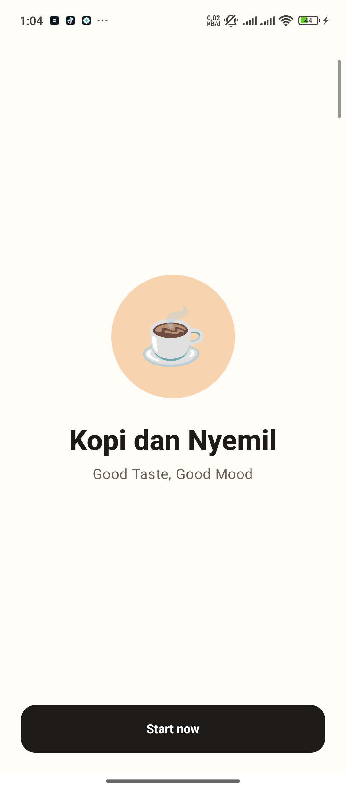
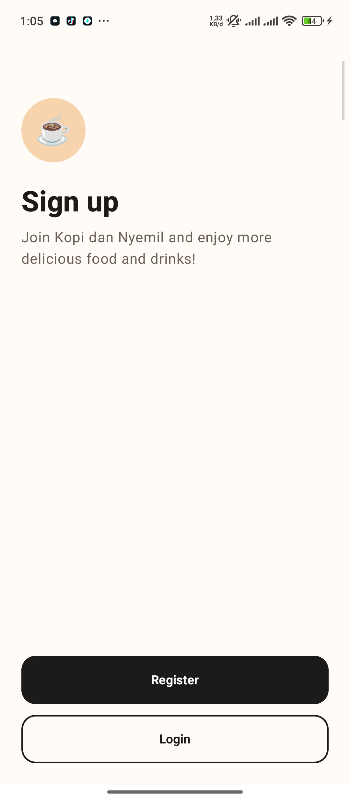
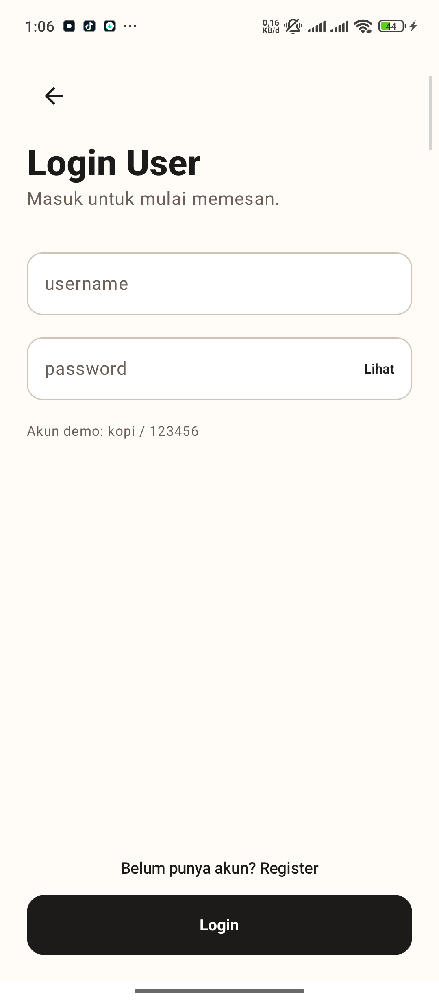
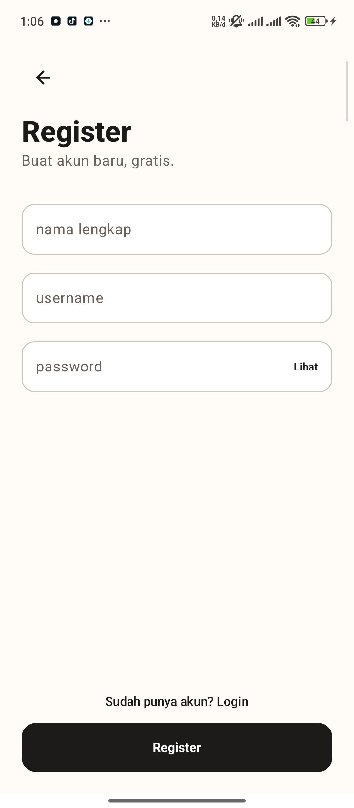
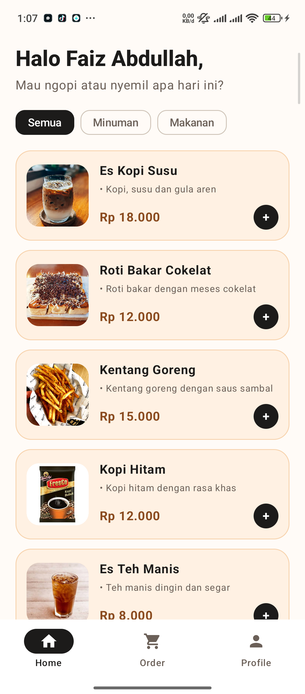
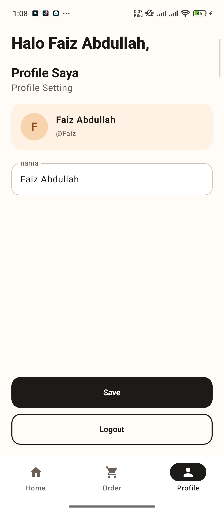
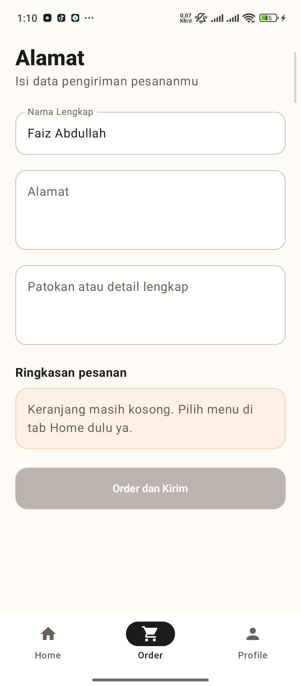

# Kopi dan Nyemil

Aplikasi pemesanan kopi dan makanan ringan berbasis Android, dibuat dengan Kotlin dan Jetpack Compose. Tampilannya mengikuti wireframe dari tugas, dan semua datanya masih dummy (tanpa database).

## Deskripsi

Di aplikasi ini pengguna bisa daftar atau login, pilih menu makanan dan minuman, isi alamat pengiriman, lalu dapat konfirmasi pesanan. Data akun, menu, keranjang, dan pesanan cuma disimpan di memori, jadi akan hilang kalau aplikasi ditutup.

## Fitur

Ada 8 layar sesuai wireframe:

1. Splash / Welcome
2. Sign up (pilih Register atau Login)
3. Login
4. Register
5. Home (daftar menu)
6. Profile
7. Alamat pengiriman (Order)
8. Konfirmasi pesanan

Beberapa hal yang ditambahkan di luar wireframe:

- Daftar menu ada 7 item, bisa difilter per kategori (Semua, Minuman, Makanan).
- Item bisa ditambah atau dikurangi jumlahnya, dan total harga langsung dihitung.
- Bottom navigation untuk pindah antara Home, Order, dan Profile.
- Validasi di form login dan register, misalnya username tidak boleh sama dan password minimal 6 karakter.
- Tombol logout di halaman Profile.

Untuk mencoba tanpa daftar, pakai akun demo ini:

- Username: `Faiz`
- Password: `123456`
## Screenshoot
## Screenshot

| Splash | Sign up | Login | Register |
|:--:|:--:|:--:|:--:|
|  |  |  |  |

| Home | Profile | Order |
|:--:|:--:|:--:|
|  |  |  |
## Teknologi

- Kotlin 1.9.24
- Jetpack Compose + Material 3
- Navigation Compose
- ViewModel untuk menyimpan state
- Android Gradle Plugin 8.5.2 (minSdk 24, targetSdk 34)

## Dibuat oleh

- Nama / NIM: FAIZ ABDULLAH FAWAZ/1247050114